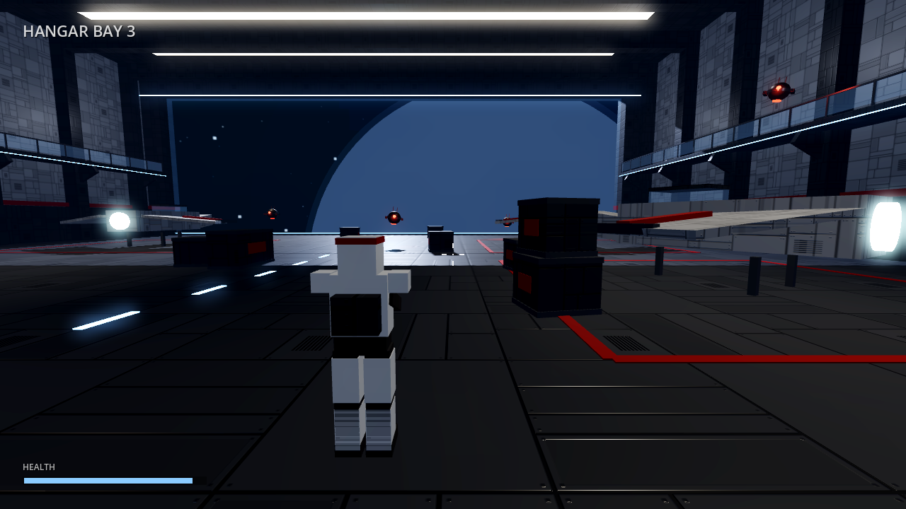
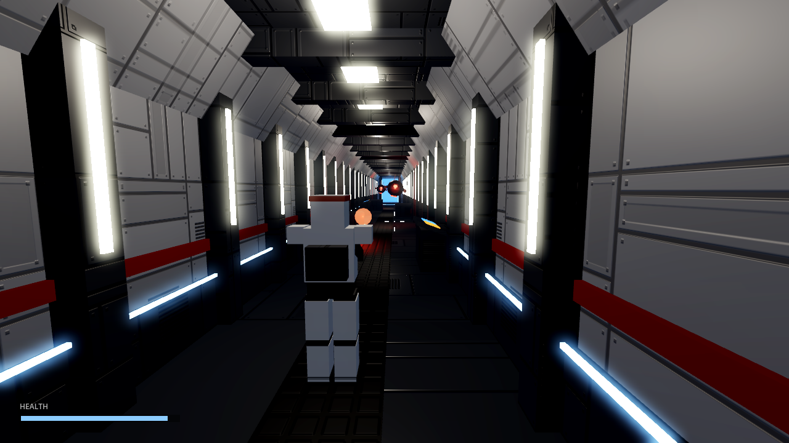
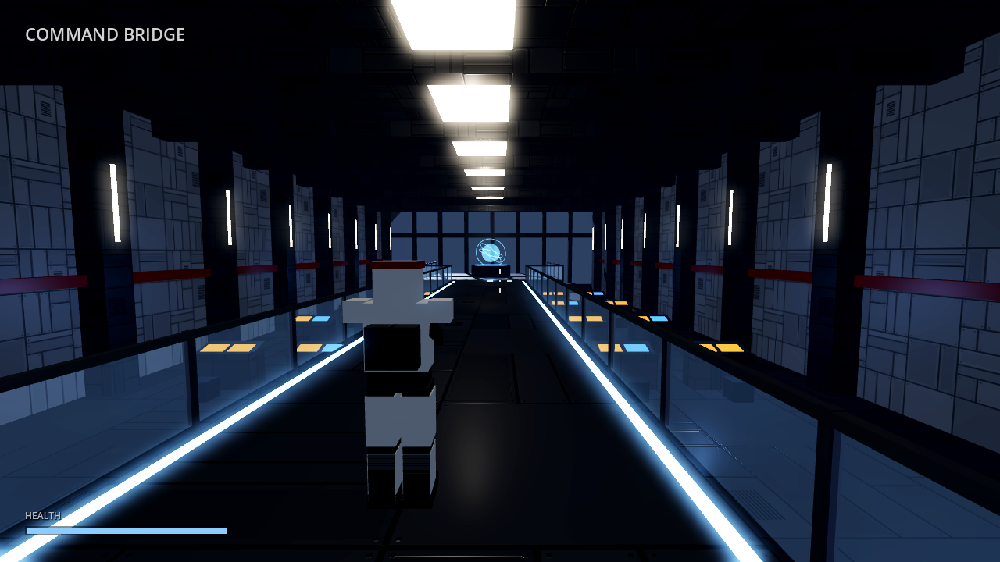

# Bulwark

A third-person shooter prototype set aboard an original Republic-era star
cruiser, the *Bulwark*. It's built in Godot 4 and runs in the browser on
GitHub Pages.

The art direction draws on the cinematic capital-ship interiors of modern
Star Wars games:

- light grey panelling with deep red trim;
- bright strip lights, glossy dark floors and blue ray shields;
- a planet hanging beyond the hangar mouth.

Every mesh, texture and name here is original. The panel textures, starfield
and planet are generated in code at startup, and no assets are borrowed.



## Play

On a computer:

- **WASD**: move. **Shift**: sprint. **Space**: jump.
- **Mouse**: look. **Left click**: fire. **Right click**: aim over the shoulder.
- **E**: use turbolifts, turrets and consoles. **F** or the corner button: fullscreen.
- **Esc**: release the mouse.

Flying a fighter (two wait on the flight deck's aft pads):

- **E** climbs in or out. **Space** lifts off; the repulsors climb clear of
  the trench, or push **W** to break off early.
- **Mouse** pitches and turns. **A/D** roll. **W/S** set throttle and
  **Shift** boosts. **Left click** fires.
- **E** lands when you're slow and low over any deck, including the
  frigate's repair bay, which fixes your hull.
- On a phone: swipe to steer, the joystick sets throttle and roll, **JUMP**
  lifts off and **USE** lands.

On a phone or tablet (landscape):

- **Left thumb**: a joystick appears wherever you touch. Push it all the way
  forward to sprint.
- **Swipe the right side**: look around.
- **FIRE**: hold to shoot. Drag your thumb across it to aim while firing.
- **AIM** toggles the zoom. **JUMP** jumps, and **USE** rides turbolifts,
  crews turrets and works consoles.
- **Fullscreen**: tap the corner button. iPhone Safari has no fullscreen
  mode, so choose Share → Add to Home Screen and launch the game from there.

## What's in the prototype

| Zone | Contents |
|---|---|
| Hangar Bay 3 | Parked fighters, crates for cover, wall catwalks, a control gallery and a ray shield open to space |
| Port Service Corridor | 40 m of ribbed corridor with console niches, ending in a lift hall with one turbolift per deck |
| Command Bridge | A walkway between crew pits, a holotable and forward viewports |
| Dorsal Flight Deck | A long trench in the top of the hull under a ray shield, with the command tower behind it. Heavy turrets on the hull are crewed from stations in the trench walls, and enemy fighters make strafing runs |
| Open Space | The frigate *Steadfast* with a repair bay you can land in, and an enemy corvette with four reactor pods to destroy, flak guns and escort fighters |
| Detention Level | A guard station and a cell block with energy-field doors. Release the cells from the guard console and lead the prisoner to the lift |

The lift hall connects the decks: the bridge straight ahead, the flight
deck on the left and detention on the right.

Enemies:

- **Sentry drones** hover in the hangar and corridor.
- **Assault droids** (original design, with reverse knees and a hammerhead
  sensor bar) fight in squads that fire together in volleys.
- **Enemy fighters** loop around the ship and strafe the flight deck.




## How it's built

### Zones stream in and out (`scripts/zone_manager.gd`)

The ship is divided into zones that share one world coordinate space. Only
these stay loaded:

- the zone the player is in;
- the zones behind any door the player is near;
- a turbolift's destination while a ride is in progress.

Everything else is freed. Doors stay shut until the zone on the far side has
loaded. Distant decks sit far apart in space and are reached by turbolift,
which hides the load behind a fade.

To add a zone:

1. Create a scene with a builder script.
2. Add an entry to `ZONES` with its bounds.
3. Connect it with a `Door` or `Turbolift` in `main.gd`.

### The modular kit (`scripts/kit.gd`)

Every wall, rib, crate and console is made by a few kit functions:

- `block`
- `strip`
- `cylinder`
- `corridor_segment`
- `console`
- `crate`
- `starfighter`

Static pieces are merged into a few meshes per material and floor cell. This
matters because the browser renderer draws each object once per light that
touches it.

To replace the greybox with authored models later, change the kit functions.
The zones don't need to change.

### Art direction (`scripts/look.gd`)

All shared materials are defined here, along with the procedural panel and
grate textures, the starfield and the input map.

### Gameplay

- `player.gd`: the over-the-shoulder spring-arm camera, movement, aiming and
  firing.
- `bolt.gd`: blaster bolts. Each frame a bolt sweeps a ray along its path, so
  it can't pass through thin walls.
- `droid.gd`: the sentry drones.
- `infantry.gd`: assault droid squads and their shared volley timing.
- `fighter.gd`: enemy fighters flying waypoint loops and attack runs.
- `turret.gd`: crewable twin cannons. While the player is seated, look
  input aims the guns.
- `prisoner.gd`: the rescued officer who follows you.
- `pilot_fighter.gd`: the flyable fighter: boarding, lift-off, flight, landing
  and the chase camera.
- `zones/space.gd`: the frigate, the corvette and its escorts.
- `hud.gd`: the heads-up display.
- `touch_controls.gd`: the joystick, look swipes and buttons for touch
  screens, plus the fullscreen button. Phones also get a lower 3D resolution
  and no sun shadows.

## Develop

Open the folder in Godot 4.4 or later (Compatibility renderer). To jump
straight into a zone or capture a frame, pass these flags:

```sh
godot --path . -- --spawn=bridge
godot --path . -- --spawn=corridor --pose=-48,0.1,0,90,0 --hold=fire --shot=/tmp/shot.png
```

In the browser, add `?spawn=corridor` to the page URL to start in that zone.

## Deploy

Every push to `main` runs `.github/workflows/deploy.yml`. The workflow:

1. downloads Godot and its web export templates;
2. exports the game single-threaded, so GitHub Pages doesn't need special
   cross-origin headers;
3. publishes the build to Pages.

One-time setup: in the repository, go to **Settings → Pages → Build and
deployment** and set the source to **GitHub Actions**.
